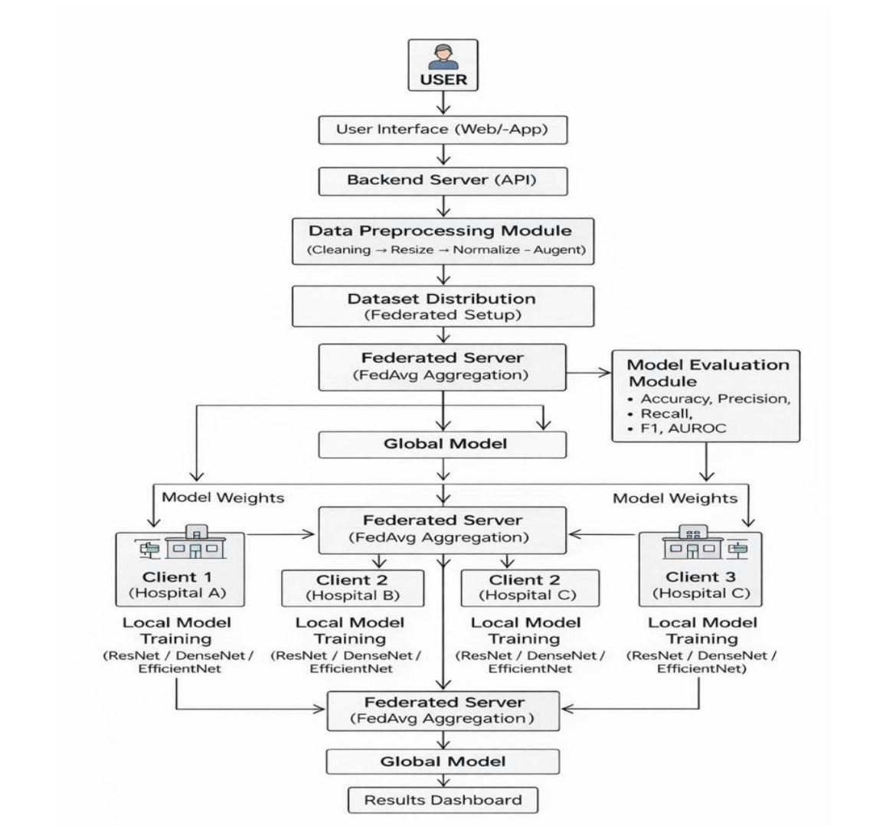
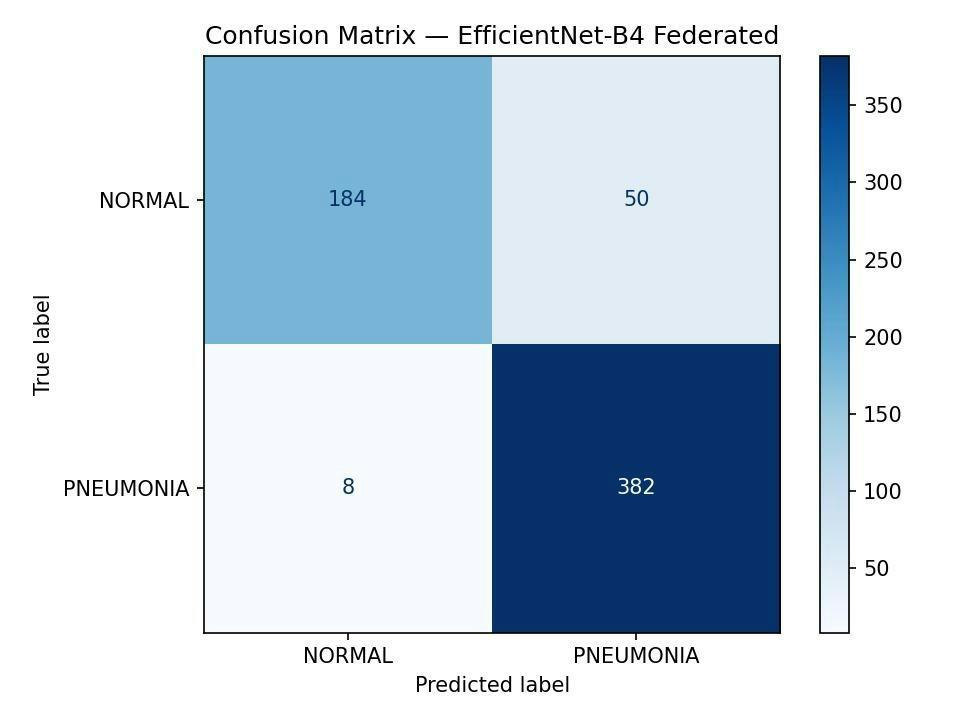
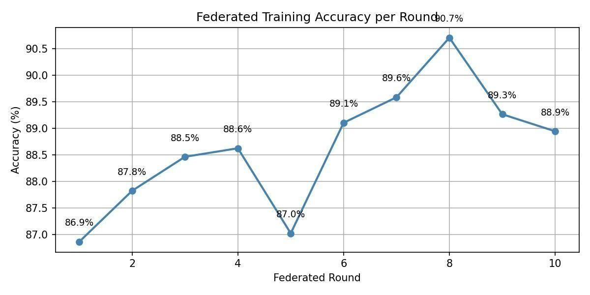
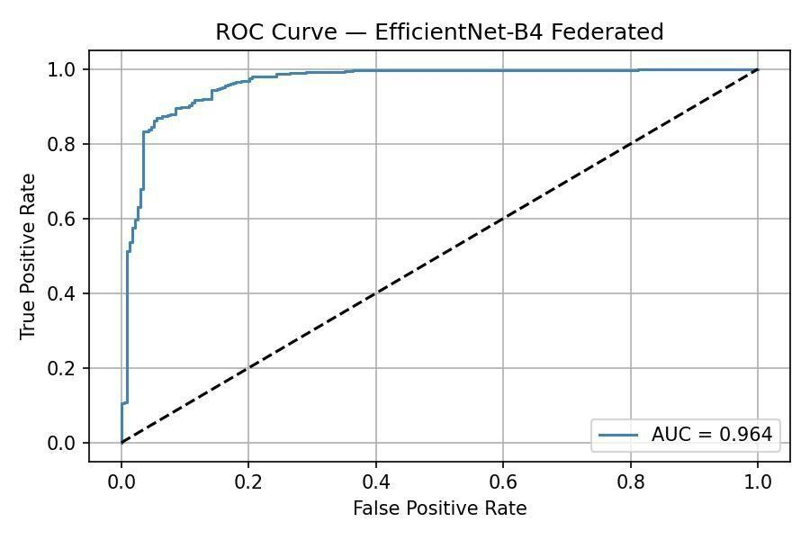
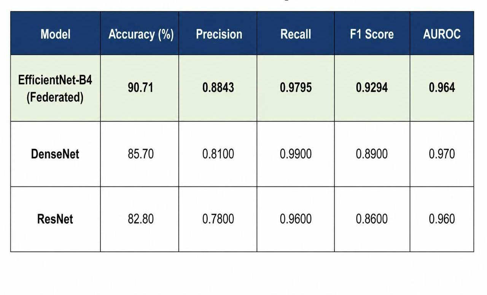

# Federated Learning-Based Pneumonia Detection in Smart Healthcare: A Comparative Study

A privacy-preserving pneumonia detector for chest X-rays. Three simulated hospitals train an EfficientNet-B4 model locally and share only model weights with a central server, which combines them with Federated Averaging (FedAvg). No raw patient images ever leave a hospital node.

Course project for **21CSE733P: AgentOps, Industrial Scale AI Deployment**, SRM Institute of Science and Technology, Kattankulathur (May 2026).

## Results at a glance

| Metric | EfficientNet-B4 (Federated) |
|---|---|
| Peak accuracy (round 8) | **90.71%** |
| Precision | 0.8843 |
| Recall | 0.9795 |
| F1 score | 0.9294 |
| AUROC | 0.964 |

Final-round accuracy (round 10) was 88.9%. Training accuracy moved from 86.9% in round 1 to a peak of 90.7% in round 8.

## Why federated learning

Hospitals cannot freely share patient scans, and centralized training means collecting all of them in one place. Here each client trains on its own data and sends back only weights, so the global model learns from all three sites while the images stay put.

## How it works

1. Collect chest X-ray images from a public dataset (5,863 images).
2. Preprocess: resize and normalize. Augment with rotation and flipping.
3. Split the data across 3 simulated hospital clients.
4. Each client fine-tunes a pretrained EfficientNet-B4 on its local data.
5. The central server averages the client weights with FedAvg and sends the global model back.
6. Repeat for 10 federated rounds, saving a checkpoint after every round.
7. Evaluate the global model on a held-out test set.



## Evaluation

The test set has 624 images (234 normal, 390 pneumonia).

### Confusion matrix

The model caught 382 of 390 pneumonia cases and missed 8. It flagged 50 normal scans as pneumonia, which is the main weakness.



### Accuracy across federated rounds



### ROC curve



### Comparison with other models



| Model | Accuracy (%) | Precision | Recall | F1 | AUROC |
|---|---|---|---|---|---|
| **EfficientNet-B4 (Federated)** | **90.71** | **0.8843** | 0.9795 | **0.9294** | 0.964 |
| DenseNet | 85.70 | 0.8100 | 0.9900 | 0.8900 | 0.970 |
| ResNet | 82.80 | 0.7800 | 0.9600 | 0.8600 | 0.960 |

EfficientNet-B4 had the best accuracy, precision, and F1. DenseNet had the highest recall and AUROC.

## Testing

10 functional test cases, all passed: valid and invalid file upload, federated round execution, FedAvg aggregation, pneumonia and normal predictions, metric computation, no raw-data transfer, checkpointing after each round, and the 3-client simulation.

## Challenges and limitations

- Training time grew with the number of communication rounds.
- Class imbalance between NORMAL and PNEUMONIA affected early rounds.
- The small validation set (16 images) made accuracy fluctuate between rounds.
- The model produces false positives (50 on the test set).
- Free GPU runtime limits on Kaggle and Colab forced per-round checkpointing.
- Binary classification only (normal vs pneumonia).

## Future work

- Class-weighted loss and stratified validation splits.
- Larger validation set and a learning-rate scheduler for stable convergence.
- Adaptive local epochs to cut communication cost.
- Explainability (for example Grad-CAM) so clinicians can see why a scan was flagged.
- Multi-class output covering pneumonia type and severity.

## Sustainable Development Goals

SDG 3 (Good Health and Well-being), SDG 9 (Industry, Innovation and Infrastructure), SDG 10 (Reduced Inequalities).

## Tech stack

Python, PyTorch, EfficientNet-B4, FedAvg, Kaggle notebooks (GPU T4).

## Repository contents

```
.
├── README.md
├── images/
└── Federated_Learning_Pneumonia_Detection_Report.pdf
```

## Team

- Keshava A K
- Jaudath Farhan
- Vatsala Singh

Guide: Dr. Dinesh G, Associate Professor, Department of Computational Intelligence, SRM Institute of Science and Technology.
